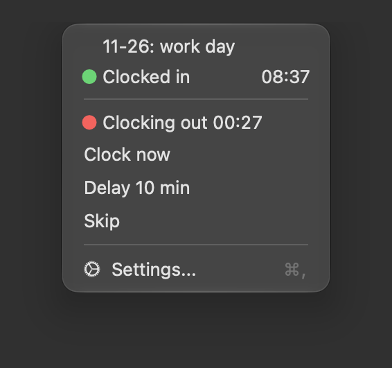
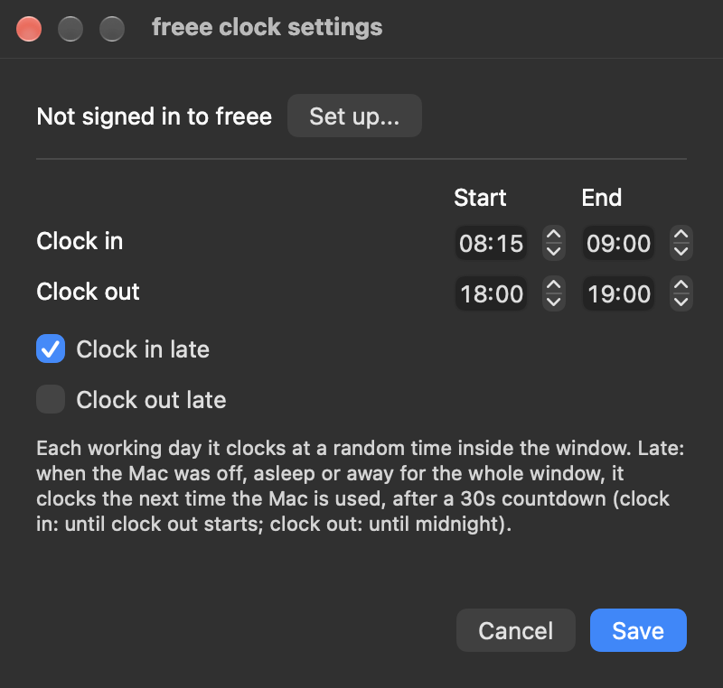
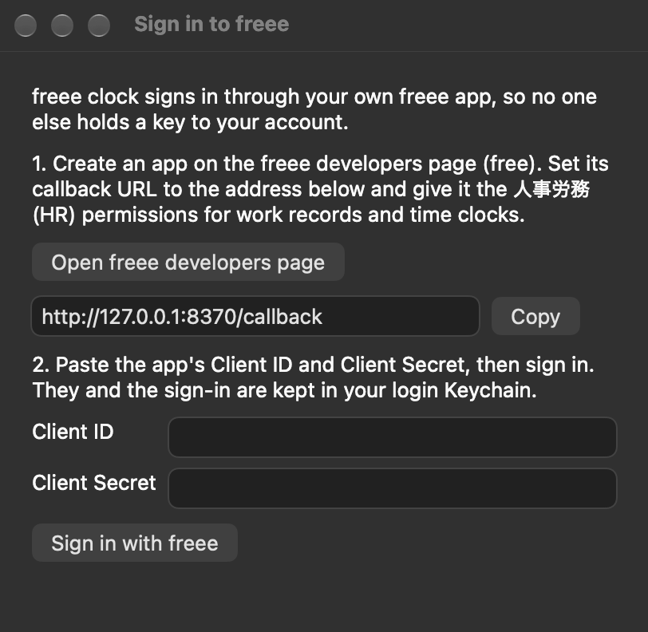

# freee clock

A macOS menu bar app that clocks you in and out on freee HR (freee 人事労務) at a random time inside your usual window, when you are at the Mac. One Swift file, no dependencies.

A personal hobby project, not made by or affiliated with freee K.K. Check that your company allows automatic clocking.



## What it does

- Working weekdays: clocks in between 08:15 and 09:00 and out between 18:00 and 19:00 (changeable in Settings).
- Skips holidays, days off, full-day leave and days you punched by hand. On partial leave it asks you to punch by hand.
- Punches only if the Mac was used in the last 10 minutes; otherwise it waits for you, up to the end of the window.
- 30 seconds before a punch, the icon flashes and the menu offers Clock now, Delay 10 min and Skip.
- Late mode: if you were away for the whole clock-in window, it clocks in when you come back. On for clock in, off for clock out.



## Setup

Needs macOS 12 or later.

```
brew install k4i-n/tap/freee-clock
brew services start freee-clock
```

`brew services` starts the app now and at every login. To build it yourself instead (needs the Xcode Command Line Tools), clone the repository and run `install.sh`; the app then runs from the cloned folder.

On first start the "Sign in to freee" window opens. Sign-in uses your own freee app, so no secret is built into this project:

1. Create an app on the freee developers page (free), linked from the window.
2. Set its callback URL to `http://127.0.0.1:8370/callback` and give it the HR permissions for work records and time clocks.
3. Paste its Client ID and Client Secret, click "Sign in with freee", and allow access in the browser.



If macOS asks whether `freee` may use the Keychain, choose "Always Allow". It asks again after each upgrade or rebuild.

## Command line

```
freee status          who you are, today's day type, what can be punched now
freee in | out        punch now
freee setup           open the sign-in window
freee demo [in|out]   40 second countdown in the menu bar, no punch
freee selftest        offline tests
```

## Data

The Client ID, Secret and tokens are in the login Keychain (service `freee-clock`); settings are in `~/.config/freee-clock/`; the log is `$(brew --prefix)/var/log/freee-clock.log` (`~/Library/Logs/freee-clock.log` with `install.sh`). The app talks only to freee.

## Uninstall

```
brew services stop freee-clock
brew uninstall freee-clock
```

With `install.sh`: `install.sh uninstall`.

Then delete `~/.config/freee-clock` and the `freee-clock` Keychain items to remove your data.

## License

MIT
